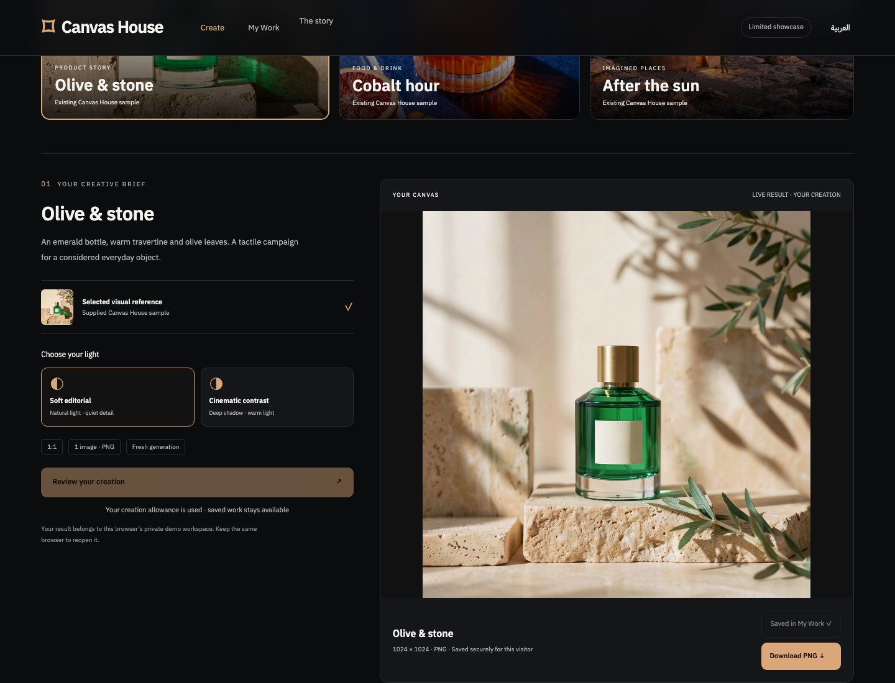
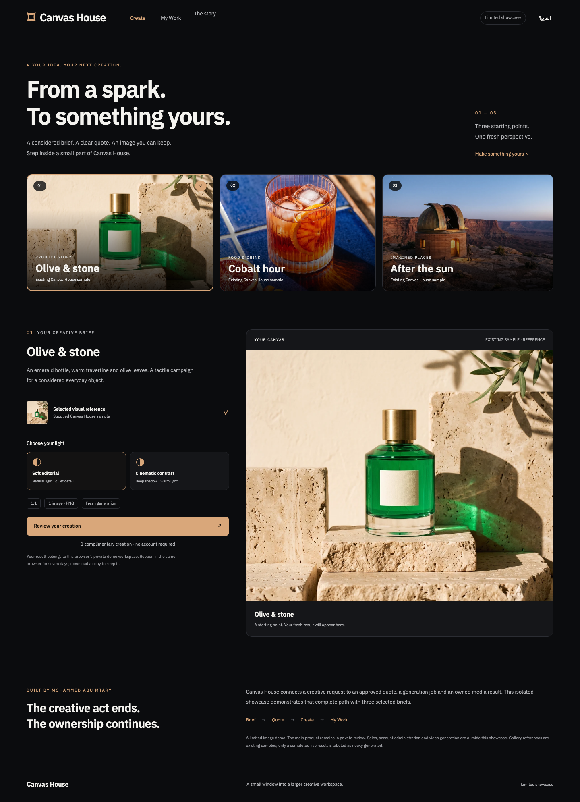

# Canvas House

**A creative brief becomes an image you can save, reopen and own.**

Creative generation is only useful when the user can understand the cost, keep the result and return to it later. Canvas House brings that complete loop into one bilingual studio.

Built by **Mohammed Abumtary** · Node.js · browser JavaScript · durable local state · server-side image provider

[Demo guide](docs/DEMO.md) · [Engineering notes](docs/ENGINEERING.md) · [Verification & boundaries](docs/VERIFICATION.md) · [Recorded walkthrough](media/walkthrough.webm)

## The experience

Creative brief → review → generate → save → reopen → download.

A limited EN/AR showcase with a recorded real image-generation journey. New generation is subject to a persistent allowance; the original product remains separate.

## Where the engineering matters

### Approve the cost first

A short-lived quote precedes generation. A durable reservation limits spending even when a request times out or the server restarts.

### Treat output as an owned artifact

Saved images have visitor ownership. Reopening and downloading use the stored output rather than paying to regenerate it.

### Keep the preview deliberately small

Three selected references and a bounded brief expose the creative workflow without distributing the private studio implementation or customer material.

## Verified in the demonstration

- 13 nonpaid acceptance groups, including ownership, concurrency and restart persistence.
- A real 1024 × 1024 PNG was generated, saved, reopened after reload and downloaded with matching bytes.
- EN/AR desktop and narrow-viewport evidence recorded.

## Explore the work

This private repository is a presentation package: screenshots, walkthrough media and engineering notes. Application source, credentials and customer records are not included. The interactive demonstration runs in a separate local review environment; access can be arranged for a walkthrough.

[Read the guided demo](docs/DEMO.md) · [View my portfolio](https://mohammed-ab.github.io/)

## Scope

This is a limited local showcase, not the full commercial studio. No production checkout, customer account or video-generation claim is made here.

Reviewed 10 November 2026. Results describe the recorded build and stated test scope.
